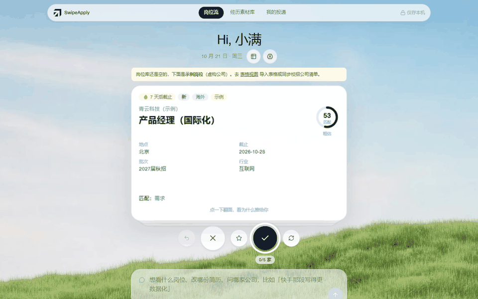
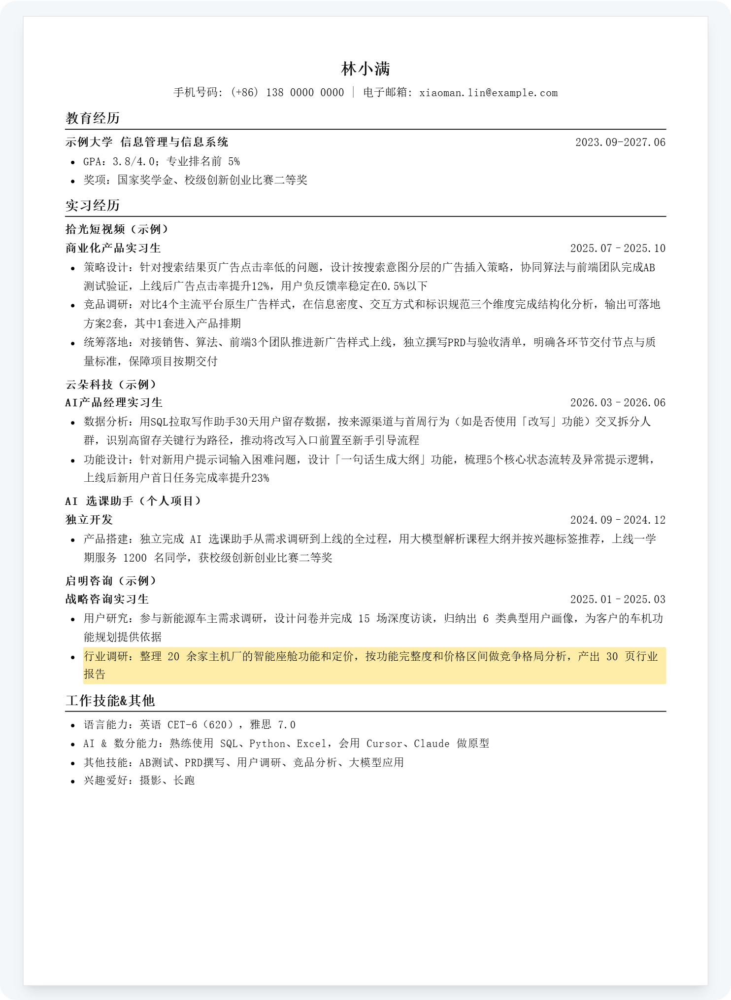

# SwipeApply · 求职工作台

打开首页像刷 Tinder 一样刷新岗位：右滑进入投递工作台，AI 按 JD 用你的经历卡片定制简历，你用语音或文字让它改；投完记进「我的投递」，回来接着刷。**所有数据只存在你电脑上的 `data/` 文件夹里。**

> **English** — SwipeApply is a local-first job-hunting workbench for campus recruiting in China. Swipe through job cards; AI matches roles to your experience, tailors a one-page A4 resume to each JD (every line traceable to your own materials, no invented numbers), and a browser extension autofills application forms (Feishu Hire, Moka, Beisen). Everything runs on your own machine — no server, your data stays in `data/`. Works out of the box with a free daily AI quota (requests are anonymized locally and relayed through the author's Cloudflare proxy, which stores no content), or bring your own LLM keys (DeepSeek / Qwen or any OpenAI-compatible API) to connect directly.

  

16 秒演示：刷岗位 → 翻面看为什么推给你 → 右滑进入工作台 → 在 A4 简历上直接改；随手编了个原句里没有的数字，马上被标红「待核对」（虚构的示例数据）

  
  

左：岗位流，AI 按 JD 对照你的经历给出匹配分和差距　右：定制简历，直接在 A4 页面上改，和导出的 PDF 一模一样（截图用的是虚构的示例数据）

**能做什么**

- **刷岗位**：右滑投递、左滑跳过，AI 从你的选择里学偏好（左滑会问为什么，按「整车 / 硬件」这样的细分方向学，不会一棍子打死整个职能）
- **定制简历**：每个岗位按 JD 挑经历、改措辞，固定一页 A4；每一句都能追溯到你素材库里的原句，数字不在原句里的会标出来；直接在 A4 页面上改，所见即所得
- **自动填网申**：浏览器插件一键填表，不替你点提交
- **投递记录**：读招聘邮件更新投递进度，首页提醒截止、测评和面试时间
- **隐私**：数据只在本机；发给模型前先在本地脱敏，你能看到发出去的全部内容

## 下载即用

1. 到 **[Releases](https://github.com/ashleywuu057-gif/SwipeApply/releases/latest)** 下载最新的 `SwipeApply-*.zip`，解压到一个固定的文件夹
2. 双击 **`启动 SwipeApply.bat`**（Windows）或 **`启动 SwipeApply（Mac）.command`**（Mac，第一次要右键 →「打开」）
3. 第一次会自动准备运行环境（5–10 分钟，都放在这个文件夹里，不装到系统），然后自动打开浏览器。**不用填任何 Key，AI 功能直接能用**
4. 首页按提示导入你的简历，就可以开始刷岗位了

以后每次用，双击一下就行。那个黑色命令行窗口别关，关了 SwipeApply 就停了。

## 免费额度和隐私

- **数据只在你电脑上**：简历、投递记录、邮件都存在这个文件夹的 `data/` 里，没有任何服务器存你的数据
- **AI 免费额度**：不填 Key 时，AI 请求经作者部署的中转（[`proxy/`](proxy)，Cloudflare）用作者的 Key，每台电脑每天约 20 万 token（大概够生成、修改 3~5 份简历），北京时间 0 点重置。发出去之前先在本地脱敏（姓名、电话等换成占位符），中转只统计用量、**不保存内容**。作者可能随时调整或停止免费额度
- **想不受限制、或者不想经过中转**：在 `.env.local` 里填自己的 Key（各几分钟，充几块钱够用一整个求职季），就直接连 DeepSeek / 通义千问：

| 填在哪 | 是什么 | 去哪申请 |
| --- | --- | --- |
| `LLM_API_KEY=` | DeepSeek：写简历、改简历、匹配岗位 | [platform.deepseek.com](https://platform.deepseek.com) |
| `SEARCH_LLM_API_KEY=` | 阿里云百炼（通义千问）：联网找岗位和 JD | [bailian.console.aliyun.com](https://bailian.console.aliyun.com) |

## 常见问题

**要付费吗？** 不用。AI 功能每天有免费额度；用自己的 Key 就按你自己的用量付给 DeepSeek / 阿里云。

**自动填网申的插件怎么装？** Edge 打开 `edge://extensions`（Chrome 是 `chrome://extensions`）→ 打开「开发人员模式」→「加载解压缩的扩展」→ 选 SwipeApply 文件夹里的 `extension/dist`。在网申页点插件 →「从 SwipeApply 同步履历」→「一键填写」，核对后**自己点提交**（插件不会替你提交）。

**Mac 提示「无法验证开发者」？** 右键点启动文件 →「打开」→ 再点「打开」，只有第一次需要。

**面试准备呢？** 还在开发，暂不建议使用。

**想改代码、从源码运行？** 看 [开发说明](docs/开发说明.md)。

## 许可证 / License

[GNU AGPL-3.0](LICENSE)。你可以自由使用、修改、分发；如果把修改后的版本作为网络服务提供给别人用，也要按 AGPL 公开源代码。需要闭源商用的授权，请在 Issues 里联系作者。

浏览器插件（`extension/`）基于 [ApplyKit](https://github.com/DeepestWind/ApplyKit)（MIT），保留其版权声明，见 `extension/LICENSE` 和 `extension/THIRD_PARTY_NOTICES.md`。
