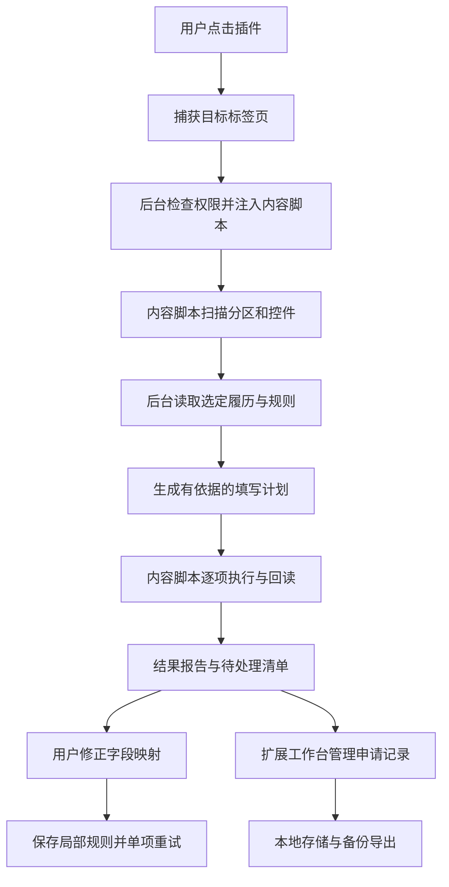

# 投简助手 ApplyKit：从零到一实施计划

版本：1.0
编写日期：2026-09-03
文档性质：产品计划、技术方案与 AI 开发任务书
目标交付：可本地安装、独立运行、能够真实操作表单的 Chrome 扩展 Demo

## 1. 项目定义与决策

项目名称为「投简助手」，英文工作名 **ApplyKit**。产品描述：维护一份履历，在招聘网页批量填写，修正不识别的字段，并记录每次申请的进展。

首要用户是使用 Chrome、在多个企业官网投递的个人求职者。优先解决重复录入、字段错位、填完后遗漏检查、投递记录分散的问题。

采用独立浏览器扩展。履历、规则、投递记录保存在扩展本地存储；不建立服务器、账号、订阅或模型服务。运行时无需 AI，常规填写的模型调用数为 0。开发过程中可以使用 AI 编写代码。

已有知识库、其他软件 JSON 或历史投递表仅作为未来迁移来源。**Demo 不读取任何固定的个人文件路径，不以个人知识库为运行依赖。** 对旧格式的兼容应实现为导入转换器，不能改变核心数据模型去迁就某个商业软件。

从零实现本方案，不默认复制其他项目。若后续选择复用开源代码，应单独记录代码来源、版本、许可证及保留的声明。本文不是 ADR，不创建或变更任何已有架构决策记录。

## 2. 最终应该看到的效果

以下是演示时必须真实发生的行为：

1. 用户在 Chrome 加载 `dist/`，点击图标，看到中文界面和「导入履历」「一键填写」「投递记录」入口。
2. 导入附带的虚构履历，能查看和编辑基础信息、教育、实习、项目等内容；保存后产生新的履历版本。
3. 打开本地演示招聘页面，点击一次「一键填写」，程序自动识别并填写确定的空字段。正常字段不逐项弹窗确认。
4. 两段教育经历分别填到正确位置。教育和项目的起止时间不会交叉；只知道月份的日期不会被虚构成某一天。
5. 遇到已填写且不同的值、未知信息、不支持的组件或无法确定的字段，保留原状并列入待处理清单。
6. 用户可在扩展工作台把一个陌生标签对应到履历字段，并选择记住规则。清空演示页后再次填写，同样结构的字段可自动匹配。
7. 填写完成后显示真实统计：已填写、原值相同、保留原值、待处理、失败。点击一项可定位网页字段。
8. 用户确认公司和岗位后保存申请记录，更新流程状态并按公司、岗位和状态筛选。再次打开相同岗位时显示已有记录。
9. 用户在网页手动提交后，在插件中确认网站已显示成功，才能把记录标为「已投递」。插件本身不点击提交。
10. 浏览器重启后履历、规则、投递记录仍在；导出后可在一个新的扩展测试环境中恢复。

界面中的数字必须来自实际执行结果，不预填「成功 30 项」之类的演示文案。本文后续给出的性能数字是验收目标，不是已有实测成绩。

## 3. 范围：什么必须做，什么以后再做

### 3.1 P0：本次 Demo 必须完成

| 模块 | 具体范围 |
| --- | --- |
| 扩展安装 | Manifest V3；Chrome 本地加载；生产构建不依赖开发服务器 |
| 履历 | 自有 JSON 格式导入导出；基础信息、求职意向、教育、实习、项目、语言、自我介绍；不可变版本快照 |
| 编辑 | 分区编辑；重复经历的新增、删除、排序；保存前格式检查；不要求富文本编辑器 |
| 填写 | 当前顶层页面；文本、文本域、原生 select、普通 radio、普通 checkbox、原生日期/月、分拆年/月 |
| 自定义控件 | 有明确 ARIA 关系的 combobox/listbox；列表非虚拟化，可等待异步出现 |
| 多段经历 | 识别明确分区及重复记录；在专用演示适配器中支持有限新增经历 |
| 校验 | 写入前重验定位，写入后检查值与可见错误；失败不计成功 |
| 修正与复用 | 手动选择字段对应关系；同网站同表单结构复用；可查看、删除规则 |
| 投递记录 | 公司、岗位、地点、链接、履历版本、日期、状态、下一步、备注；去重提示与搜索 |
| 数据迁移 | 全量 JSON 备份恢复；投递记录 CSV 导入导出；导入预览及错误报告 |
| 结果反馈 | 字段级报告、当前运行进度、停止后续填写、定位待处理字段 |
| 演示与测试 | 3 个真实可交互的本地模拟页面、虚构样例、自动化测试、人工 Chrome 加载验证 |

### 3.2 P1：Demo 验收后再做

- 从用户最常用的招聘网站中选 1–3 种真实模板做适配；依据实际 DOM 编写规则。
- 省市区联动、虚拟滚动下拉、弹窗式新增经历、富文本、可访问的 iframe / Shadow DOM。
- 用导入转换器迁移旧 JSON、Markdown 知识库与投递日志。
- 根据特定网站的成功页面提供「疑似提交成功」提示；仍需用户确认记录。
- 岗位级履历覆盖、多版本比较、脱敏诊断包。
- 可选 AI 辅助字段映射：只处理规则未命中的字段，结果经验证后复用。

### 3.3 P2：长期扩展

- 本地文件自动同步、供外部 AI 调用的接口、跨设备同步。
- 邮件或面试日历联动、商店发布与自动更新。

### 3.4 本次不做

不实现自动找岗、后台批量投递、自动上传附件、验证码识别、登录管理、自动勾选声明、自动点击最终提交，也不提供成功率或录用率预测。未知字段不能由程序编造。

P0 以 3 个本地页面为确定的验收范围。通用识别器可在真实网页尝试工作，但这不等于已适配所有招聘网站。真实站点的验证状态必须单独列明。

## 4. 用户流程与页面

### 4.1 首次配置

点击图标 → 导入履历 → 显示格式校验与内容预览 → 保存 → 当前版本可用。

首次导入后只进行一次资料审阅。正常使用时无需每次重新导入，也无需每次把完整履历交给 AI。

标记为 `source.type=demo` 或 `source.status=fictional` 的资料只能在 loopback 演示页面填写。真实求职资料通过独立导入/编辑流程建立，不能一键把虚构测试资料改成真实资料使用。

导入文件分为「履历文件」「完整备份」「投递 CSV」三个明确入口，避免把记录文件当作履历。只在用户确认导入预览后替换或追加数据；无效文件不改变已有数据。

### 4.2 日常填写

1. 用户在招聘网页打开插件，插件捕获当前 `tabId`、origin 和页面身份。
2. 弹窗显示当前履历版本与页面；可以先扫描，也可以直接「一键填写」。
3. 扫描后发现可识别岗位信息时，展示公司/岗位候选。首次保存记录需要用户核对；缺少岗位信息不阻止单独填表。
4. 只填写确定的普通空字段。执行中显示进度，并提供停止按钮。
5. 结束后显示结果摘要。「查看详情」在扩展自己的工作台中打开，不把完整履历放到招聘页面浮窗。
6. 对未识别项选择对应字段后，可单项重试；可勾选「记住对应关系」。对已有不同内容的字段，覆盖必须由用户针对该项发起。
7. 由用户完成附件、声明与提交操作，插件保存明确的申请状态。

### 4.3 界面规格

| 界面 | 内容与交互 |
| --- | --- |
| 工具栏弹窗 `popup.html` | 宽约 380px；当前履历、当前网站、扫描、一键填写、停止、上次摘要；打开履历管理和记录页 |
| 工作台 `app.html#profiles` | 履历列表、当前版本、编辑器、导入、导出；记录排序用上移/下移即可 |
| 工作台 `app.html#review/<runId>` | 按状态筛选的字段清单；网页标签、所属经历、源字段、结果原因；定位、重试、手动映射 |
| 工作台 `app.html#applications` | 表格；搜索与状态筛选；新增、修改、重复提示、CSV 导入导出 |
| 工作台 `app.html#rules` | 网站、表单/分区、网页标签、源字段、更新时间；删除不再适用的规则 |
| 工作台 `app.html#backup` | 导出完整备份、恢复备份、数据占用说明；不默认上传云端 |

界面使用中文。状态除了颜色，还须有文字。表单标签与按钮可用键盘访问。失败项使用「缺少毕业月份」「找到两个同名字段」等具体原因，不只显示技术错误码。

招聘页上可插入短暂的字段高亮和不含个人信息的进度提示。所有完整履历预览、记录和规则管理均在 `chrome-extension://` 页面中完成。

## 5. 技术选型与构建

### 5.1 固定选型

| 层 | 选择 | 原因 |
| --- | --- | --- |
| 语言 | TypeScript，strict 开启 | 字段、消息、状态都能通过类型约束 |
| 扩展 | Chrome Manifest V3 | 支持本地加载与当前页面脚本注入 |
| UI | 原生 HTML/CSS + TypeScript DOM | 控制 Demo 依赖与构建复杂度 |
| 构建 | esbuild + Node 构建脚本 | 分别输出内容脚本 IIFE 与扩展页面/后台 ESM |
| 数据校验 | Zod | JSON 导入、消息和持久化数据使用运行时校验 |
| 本地存储 | `chrome.storage.local` | 适合个人规模的结构化履历、规则和记录 |
| 单元测试 | Vitest | 测试纯函数匹配、日期、去重、迁移 |
| 浏览器测试 | Playwright 自带 Chromium | 以真实扩展加载方式测试 DOM 操作 |
| 演示站 | Node 静态服务器，绑定 `127.0.0.1:4173` | 本地、可重复、无需部署 |

使用当前稳定的 Node LTS 与兼容的依赖版本。创建项目时记录实际 Node 版本，生成并提交 `package-lock.json`；后续按 `npm ci` 重建，不在运行时下载代码。不要依赖未经验证的某个最新版 API。

### 5.2 依赖与命令合同

首次建立 `package.json`，至少配置 `type: module`、`private: true` 与下列脚本。开发依赖包含 `typescript`、`esbuild`、`@types/chrome`、`@types/node`、`vitest`、`@playwright/test`；运行依赖仅需 `zod`，必须打包进产物。

| 命令 | 必须执行的行为 |
| --- | --- |
| `npm run build` | 清理并生成生产 `dist/`，校验 manifest 引用均存在 |
| `npm run dev` | watch 源文件并重新构建；不承诺自动刷新 Chrome 扩展 |
| `npm run typecheck` | `tsc --noEmit` |
| `npm test` | 运行 Vitest 单元测试 |
| `npm run demo` | 启动只提供演示页面与公开虚构样例的本地服务器 |
| `npm run build:e2e` | 单独生成 `.test-dist/`，仅该测试产物增加 loopback host 权限 |
| `npm run test:e2e` | 运行真实扩展的端到端测试，自动启动/关闭测试服务器 |
| `npm run verify` | 类型检查、单元测试、生产构建、端到端测试顺序完成 |

首次开发可以安装依赖；锁文件生成后，README 的复现步骤应为：

```bash
npm ci
npx playwright install chromium
npm run verify
npm run demo
```

随后在 Chrome 加载 `dist/` 并访问 `http://127.0.0.1:4173/basic.html`。端到端自动化使用 Playwright 附带的 Chromium 和独立临时 profile；不修改用户的日常 Chrome 配置。官方目前推荐这种扩展测试方式。[Playwright 扩展测试](https://playwright.dev/docs/chrome-extensions)

### 5.3 生产 manifest

```json
{
  "manifest_version": 3,
  "name": "投简助手 ApplyKit",
  "version": "0.1.0",
  "description": "使用本地履历填写招聘表单，校验结果并管理投递记录。",
  "permissions": ["activeTab", "scripting", "storage"],
  "action": {
    "default_title": "投简助手",
    "default_popup": "popup.html"
  },
  "background": {
    "service_worker": "background.js",
    "type": "module"
  },
  "options_page": "app.html",
  "content_security_policy": {
    "extension_pages": "script-src 'self'; object-src 'self'"
  }
}
```

P0 不申请 `tabs`、`history`、`cookies`、`debugger`、`downloads`、`<all_urls>` 或 Native Messaging 权限。下载备份使用扩展页面中的 Blob 与带 `download` 属性的链接；仅下载用户主动选择的导出文件。

`activeTab` 在用户点击扩展时临时授权当前页面，跨 origin 导航后须重新点击插件；普通网页之外的受限页面应明确提示无法填写。[Chrome activeTab](https://developer.chrome.com/docs/extensions/develop/concepts/activeTab)

### 5.4 构建约束

- `src/background/index.ts` 输出为 `dist/background.js`，ESM。
- `src/content/index.ts` 输出为 `dist/content.js`，单文件 IIFE，无外部 import，无动态 import。
- 弹窗和工作台输出为 `dist/popup.js`、`dist/app.js`；HTML 使用外部 module script，不使用内联脚本或内联事件处理器。
- `scripts/build.mjs` 复制 `public/` 下 HTML/CSS/图标和 manifest；测试、演示页、真实数据不进入 `dist/`。
- 开发构建可保留 source map；发布产物不得包含环境变量、个人资料、API key 或本机绝对路径。
- 不用页面 `eval`、远程脚本、网站未公开接口或绕过机制实现填写。

## 6. 代码目录与模块职责

```text
ApplyKit/
├── AI-START.md
├── README.md                         # 安装、开发、演示、限制
├── package.json
├── package-lock.json
├── tsconfig.json
├── vitest.config.ts
├── playwright.config.ts
├── .gitignore
├── public/
│   ├── manifest.json
│   ├── popup.html
│   ├── app.html
│   └── styles.css
├── scripts/
│   ├── build.mjs
│   ├── build-e2e.mjs
│   └── demo-server.mjs
├── src/
│   ├── shared/
│   │   ├── schemas.ts                # 持久化及交换格式的 Zod schema
│   │   ├── types.ts
│   │   ├── protocol.ts               # 消息 schema 与来源检查
│   │   ├── field-catalog.ts          # 可填字段路径、类别、别名
│   │   ├── normalize.ts
│   │   ├── dates.ts
│   │   ├── matching.ts               # 纯函数字段匹配
│   │   ├── fingerprints.ts
│   │   └── urls.ts
│   ├── background/
│   │   ├── index.ts                  # 所有消息监听顶层注册
│   │   ├── storage.ts                # 唯一持久化写入口
│   │   ├── migrations.ts
│   │   ├── coordinator.ts            # 绑定 tab/document/run，分派扫描与执行
│   │   ├── profiles.ts
│   │   ├── rules.ts
│   │   └── applications.ts
│   ├── content/
│   │   ├── index.ts                  # 注入幂等、消息入口、页面生命周期
│   │   ├── scanner.ts                # DOM -> FieldDescriptor
│   │   ├── sections.ts               # 分区与重复记录
│   │   ├── executor.ts               # 有限顺序执行、停止、检查过期
│   │   ├── verify.ts
│   │   ├── highlight.ts
│   │   ├── controls/
│   │   │   ├── text.ts
│   │   │   ├── select.ts
│   │   │   ├── choice.ts
│   │   │   ├── date.ts
│   │   │   └── combobox.ts
│   │   └── adapters/
│   │       ├── types.ts
│   │       ├── registry.ts
│   │       ├── generic.ts
│   │       └── demo.ts
│   └── ui/
│       ├── popup.ts
│       ├── app.ts
│       ├── profile-editor.ts
│       ├── review.ts
│       ├── applications.ts
│       ├── rules.ts
│       └── import-export.ts
├── fixtures/
│   ├── profile.demo.json             # 已提供，全部虚构
│   ├── applications.demo.json        # 已提供，全部虚构
│   └── invalid/                      # 开发时添加无效输入样例
├── demo/
│   ├── basic.html
│   ├── experience.html
│   ├── edge-cases.html
│   ├── demo.css
│   └── demo.js
├── tests/
│   ├── unit/
│   └── e2e/
├── docs/
│   ├── 从零到一实施计划.md
│   ├── IMPLEMENTATION-STATUS.md
│   ├── DEMO-ACCEPTANCE.md
│   └── SITE-COMPATIBILITY.md
├── dist/                             # 构建生成
└── .test-dist/                       # 测试生成，不作为安装交付
```

`.gitignore` 至少排除 `node_modules/`、构建产物、浏览器测试 profile、截图/trace 中的非公开数据、`.env*`、`private-data/`、个人备份文件。只允许 `fixtures/` 中明确虚构的资料进入版本控制。

## 7. 数据模型与交换格式

### 7.1 统一约定

- 所有交换文件包含 `kind` 与 `schemaVersion: 1`；先识别文件类型，再校验 schema。
- 未知值使用 `null`，数组使用 `[]`；禁止用「暂无」「未填写」自动填入网站。
- 布尔值 `false` 是有效值，不能被 `if (!value)` 当作缺失。
- 持久化时间使用 UTC ISO 字符串；显示日期按 `Asia/Shanghai` 或用户设置的时区格式化。
- 履历中的年月日使用结构化日期，不通过 JavaScript 时区转换推导生日或毕业日期。
- Profile 导入的 `source.status` 是资料来源声明，不自动证明其真实；由导入预览完成本次数据审阅。

### 7.2 履历 schema

下列 TypeScript 是必须实现的结构合同。Zod 校验需与之保持一致，附带样例文件是对应合法实例。

```ts
type PartialDate = { year: number; month?: number; day?: number };
type EndDate = PartialDate | { present: true };
type DegreeLevel = 'bachelor' | 'master' | 'doctor' | 'associate' | 'other';

interface ProfileData {
  personal: {
    fullName: string;
    englishName: string | null;
    email: string | null;
    phone: string | null;
    birthDate: PartialDate | null;
    currentCity: string | null;
    homepage: string | null;
    github: string | null;
  };
  preferences: {
    targetRoles: string[];
    preferredCities: string[];
    availabilityText: string | null;
    internshipMonths: number | null;
    daysPerWeek: number | null;
    acceptsRelocation: boolean | null;
  };
  education: Array<{
    id: string;
    school: string;
    department: string | null;
    degreeLevel: DegreeLevel;
    enrollmentStatus: 'enrolled' | 'graduated' | null;
    major: string | null;
    startDate: PartialDate | null;
    endDate: PartialDate | null;
    gpa: string | null;
    gpaScale: string | null;
    description: string | null;
  }>;
  internships: Array<{
    id: string;
    company: string;
    department: string | null;
    title: string | null;
    city: string | null;
    startDate: PartialDate | null;
    endDate: EndDate | null;
    description: string | null;
  }>;
  projects: Array<{
    id: string;
    name: string;
    role: string | null;
    startDate: PartialDate | null;
    endDate: EndDate | null;
    url: string | null;
    description: string | null;
  }>;
  languages: Array<{
    id: string;
    language: string;
    certificate: string | null;
    score: string | null;
    examDate: PartialDate | null;
  }>;
  selfIntroduction: string | null;
}

interface ProfileFile {
  kind: 'applykit-profile';
  schemaVersion: 1;
  profileId: string;                   // 同一履历系列的稳定标识
  profileVersionId: string;            // 不可变快照标识
  name: string;
  createdAt: string;
  source: {
    type: 'demo' | 'manual' | 'import';
    status: 'fictional' | 'user-reviewed';
    note: string | null;
  };
  data: ProfileData;
}
```

出生日期 P0 可保存，但默认作为需逐项确认的字段；身份证、精确住址、健康、政治面貌、家庭联系人等不进入 P0 履历模型。网站出现这些字段时列为待处理，不能拿其他字段代替。

普通值的存储校验：文本默认不超过 10,000 字符；手机号使用字符串，允许常见国际区号；邮箱校验格式但不要求联网验证；URL 只接受 http/https；日期校验闰年和日期真实存在，存在 day 必须有 month。每类经历上限 20 条，ID 在各自集合内唯一。导入文件上限 2 MiB；未知版本拒绝，给出具体错误路径。

**版本规则：**编辑保存生成新的 `profileVersionId`，保留原版本；同一经历的 `id` 在编辑和排序后不变。投递记录引用实际使用的版本，后续编辑不能改写历史引用。P0 暂不提供删除被记录引用的版本，避免悬空引用。

导入同 versionId 且内容完全相同的文件是幂等操作；同 versionId 但内容不同必须提示冲突，用户选择另存时生成新 versionId，不能覆盖快照。编辑器中的 demo/fictional 标识不可切换为真实，真实资料通过新的手动资料系列或单独的真实资料文件建立。

### 7.3 字段目录与引用

所有可填值通过字段目录读取，禁止让网页或缓存规则携带任意 JS 路径、表达式或代码。

```ts
type SectionKind = 'personal' | 'preferences' | 'education' |
  'internships' | 'projects' | 'languages' | 'selfIntroduction' | 'unknown';

interface FieldRef {
  section: Exclude<SectionKind, 'unknown'>;
  recordId?: string;                  // 重复经历必须提供
  field: string;                      // 必须出现在该 section 的白名单中
}
```

例如 `{ section: 'education', recordId: 'edu-demo-master', field: 'major' }`。源字段选择器向用户显示「硕士教育 / 软件工程 / 专业」，不要求用户输入代码路径。

`selfIntroduction` 为特殊单值分区，统一使用 `{section:'selfIntroduction', field:'text'}`。日期只有一个源字段引用，具体年月拆分由日期投影器产生。数组型偏好只有在目标支持多选，或页面明确接受列表文本时才能自动写入；不能在单选框擅自选 preferredCities 的第一项。

自动填写的所有值来自当前已审阅版本。别名与格式转换可以改变表示形式，不能推导新事实；长文本不擅自截断，字数限制不足则等待用户编辑后保存新版本或单次手动填写。

### 7.4 投递记录 schema

```ts
type ApplicationStatus =
  | 'planned' | 'filling' | 'ready' | 'applied'
  | 'assessment' | 'interview' | 'offer' | 'rejected' | 'closed';
type Blocker = 'none' | 'missing_information' | 'site_restriction';

interface ApplicationRecord {
  id: string;
  company: string;
  role: string;
  location: string | null;
  sourceUrl: string | null;
  canonicalUrl: string | null;
  externalJobId: string | null;
  dedupeKey: string;
  profileVersionId: string | null;
  status: ApplicationStatus;
  blocker: Blocker;
  createdAt: string;
  updatedAt: string;
  appliedAt: string | null;
  nextAction: string | null;
  notes: string | null;
  submissionEvidence: null | {
    kind: 'user-confirmed' | 'imported';
    confirmedAt: string;
    successSeen: true;
    note: string | null;
  };
  timeline: Array<{
    at: string;
    from: ApplicationStatus | null;
    to: ApplicationStatus;
    reason: string | null;
  }>;
}

interface ApplicationsFile {
  kind: 'applykit-applications';
  schemaVersion: 1;
  exportedAt: string;
  records: ApplicationRecord[];
}
```

状态显示依次为：待投递、填写中、待确认提交、已投递、笔试/测评、面试、Offer、未通过、已结束。`blocker` 独立记录阻塞原因，不把失败填写误判为招聘方拒绝。

`ready` 由用户复核后设置，不等于所有网站步骤均完成。P0 新记录只能为 `planned`、`filling` 或 `ready`；转为 `applied` 必须从扩展工作台收到用户明确确认「已手动提交，且看到网站成功提示」，写入 `appliedAt` 与证据。未记录提交证据时不能跳转到后续招聘阶段。

普通 `UPSERT_APPLICATION` 不接受首次设置 appliedAt/submissionEvidence，也不能凭客户端自带证据进入 applied。`CONFIRM_SUBMITTED` 是正常使用中的唯一提交确认入口；专门的历史导入流程除外。timeline 由后台依据实际状态变化追加，普通编辑不能改写旧事件。

导入历史记录可以带 `kind: imported` 的证据，并在导入预览中单独核对；它表示导入者的历史声明，不表示插件亲自验证。撤回错误状态只能通过显式纠正操作，并追加 timeline；不得静默回退。

### 7.5 存储根结构

```ts
interface AppState {
  schemaVersion: 1;
  revision: number;
  activeProfileVersionId: string | null;
  profiles: ProfileFile[];
  applications: ApplicationRecord[];
  mappings: SavedMapping[];
  recentRuns: RunReport[];
  processedMutations: Array<{ requestId: string; revision: number }>;
  settings: { timezone: string };
}
```

整个状态保存为一个 `applykit.state.v1` 键。只有后台 worker 可写入；弹窗、工作台和内容脚本必须发消息请求。后台对写操作排队，写入成功后才回应。`requestId` 去重避免客户端重试造成重复记录。

后台第一次处理事件前初始化并校验状态，使用 `storage.local.setAccessLevel({accessLevel: 'TRUSTED_CONTEXTS'})` 限制内容脚本直接读存储。所有消息处理等待同一个初始化 Promise；`onInstalled` 只补缺省值，不清空资料。

单键保存便于 P0 一致备份；它不是通用事务数据库。每次变更读取最新状态、校验 revision、生成副本、一次 `set`、返回 revision。UI 修改携带 `expectedRevision`，冲突时提示重新载入而非覆盖他人修改。已有 mutation ID 的重试直接回应成功。

保存最近 50 次脱敏运行报告和最近 100 个 mutation ID；不自动删除投递记录或履历。接近 7 MiB 时拒绝进一步增长并提示导出/整理，捕获配额错误并保持上次成功状态。不要申请无限容量来掩盖保留策略问题。Chrome 本地存储有配额，且卸载扩展会移除数据。[Chrome Storage](https://developer.chrome.com/docs/extensions/reference/api/storage)

完整备份的外层格式为 `{ kind: 'applykit-backup', schemaVersion: 1, exportedAt, state }`。备份是明文文件，导出界面应明确这一点。恢复只支持整库替换，先预览数量与警告，再一次写入；P0 不实现复杂的双向冲突合并。

## 8. 整体运行架构



### 8.1 三个执行区域

- **扩展 UI：**管理履历、用户意图、字段修正、投递状态、导入导出。完整私人资料只在这里呈现。
- **后台 worker：**唯一持久化写入口，验证消息来源、选定资料版本、字段匹配、运行协调。不得依赖 worker 永不休眠。
- **内容脚本：**读取当前网页、执行已生成的动作、回读和高亮。只收到本轮需要填写的值，不取得完整履历或整个投递历史。

Chrome 会按生命周期停止和重启扩展 worker，因此状态必须落库；填写循环放在目标页面的内容脚本中，不放在弹窗或一个长时间挂起的后台请求里。[Worker 生命周期](https://developer.chrome.com/docs/extensions/develop/concepts/service-workers/lifecycle)

### 8.2 扫描与填写的完整时序

1. 用户点击插件后，popup 捕获目标 tab。即使随后打开工作台，目标仍是这个 tab，不改成工作台自己的标签页。
2. popup 发起 `PREPARE_RUN`，指定 `targetTabId`、选定的 `profileVersionId` 和模式 `scan` 或 `fill`。
3. 后台验证页面是普通 http/https、权限存在，然后通过 `chrome.scripting.executeScript` 注入打包的 `content.js`。脚本使用隔离世界内的版本标记防止重复绑定事件。
4. 内容脚本向后台登记实际 tab/frame/document 身份。后台生成 `runId` 和随机 session nonce，绑定 `tabId + frameId=0 + documentId + origin + routeKey`。
5. 后台发起扫描，内容脚本返回有上限的描述符和岗位候选。后台生成匹配计划。只有直接填表模式才进一步执行。
6. 后台在 `recentRuns` 中保存本轮元数据和初始状态，再向该 document 发送最小动作列表。若关联了已核对的申请记录，此时更新为「填写中」。
7. 内容脚本依次操作；每个控件都重验身份、值、可见性。结构变化时重扫局部模块并重新映射，不能拿旧索引继续填写。
8. 每完成一项回传不含字段值的进度，后台保存运行统计；UI 可订阅 storage 变化或定时读取摘要。弹窗关闭后任务继续。
9. 若页面导航、刷新、脚本失联或扩展被重载，停止该轮，不在新页面自动续填。下次打开插件标为中断，用户重新扫描。
10. 整轮结束持久化报告。失败项不会触发无限重试，也不会自动修改申请为「已投递」。

`executeScript` 与扩展消息是官方提供的页面执行/通信方式。[脚本注入](https://developer.chrome.com/docs/extensions/reference/api/scripting)、[消息机制](https://developer.chrome.com/docs/extensions/develop/concepts/messaging)

### 8.3 运行状态和消息合同

```ts
type RunPhase = 'scanning' | 'planned' | 'filling' | 'completed' |
  'cancelled' | 'interrupted' | 'failed';

interface Envelope<T> {
  protocolVersion: 1;
  requestId: string;
  type: string;
  payload: T;
}

type Reply<T> =
  | { ok: true; requestId: string; data: T }
  | { ok: false; requestId: string; error: { code: string; message: string } };
```

所有消息必须有 Zod discriminated union，不接受 `type: any` 的兜底执行器。协议至少包括：

| 方向 | 消息 | 数据与结果 |
| --- | --- | --- |
| UI → 后台 | `GET_STATE` | 返回 UI 所需状态 |
| UI → 后台 | `SAVE_PROFILE` / `IMPORT_PROFILE` | 文件及 expectedRevision；校验后保存新版本 |
| UI → 后台 | `SET_ACTIVE_PROFILE` | 已存在的 profileVersionId、expectedRevision |
| UI → 后台 | `PREPARE_RUN` | targetTabId、profileVersionId、mode、可选 applicationId；返回 runId |
| 后台 → 内容脚本 | `SCAN_PAGE` | runId、nonce；返回描述符、分区、岗位候选、routeKey |
| 后台 → 内容脚本 | `EXECUTE_PLAN` | runId、nonce、documentId、planRevision、受限动作列表 |
| 内容脚本 → 后台 | `RUN_PROGRESS` / `RUN_FINISHED` | runId、nonce、递增 seq、状态与脱敏字段结果 |
| UI → 后台 | `GET_RUN` / `CANCEL_RUN` | runId；后台将取消请求路由到原 document |
| UI → 后台 | `RETRY_FIELD` / `SAVE_MAPPING` | runId、fieldId、白名单 FieldRef、仅本次覆盖选项 |
| UI → 后台 | `LOCATE_FIELD` | runId、fieldId；不携带选择器代码 |
| UI → 后台 | `UPSERT_APPLICATION` | 记录、expectedRevision；执行去重及状态校验 |
| UI → 后台 | `CONFIRM_SUBMITTED` | recordId、successSeen=true、appliedAt、expectedRevision |
| UI → 后台 | `EXPORT_BACKUP` / `IMPORT_BACKUP` | 导出/校验后的替换请求 |
| UI → 后台 | `IMPORT_APPLICATIONS` / `DELETE_MAPPING` | 预览后的记录集合 / 规则 ID |

不同端只接受表内允许的消息。以真实 `sender.id`、`sender.url`、`sender.tab.id`、`sender.frameId`、`sender.documentId` 检查来源，不相信 payload 自报的来源。管理接口只允许扩展自己的 `popup.html` 与 `app.html`；内容脚本只能回传已登记运行的进度与扫描结果。

P0 不配置 `externally_connectable`，不通过 `window.postMessage` 或网页 DOM 事件开放管理接口。招聘网页不能读取、删除或修改投递记录，也不能要求插件导出个人资料。普通页面文本只作为待识别内容，不作为程序指令。

后台事件监听应在模块顶层注册。异步响应使用 `sendResponse` 并返回字面值 `true` 的兼容写法；不要把整个填写过程挂在一个消息响应上。每个短请求超时 10 秒，执行任务独立报告进度。

## 9. 表单识别和字段映射

### 9.1 描述符

```ts
type ControlKind = 'text' | 'textarea' | 'select' | 'radio' |
  'checkbox' | 'date' | 'month' | 'combobox' | 'unsupported';

interface FieldDescriptor {
  fieldId: string;                       // 本次扫描内唯一，不能跨刷新复用
  section: SectionKind;
  sectionInstanceId: string;
  recordInstanceId: string | null;
  label: string;
  normalizedLabel: string;
  nameHint: string | null;
  placeholderHint: string | null;
  controlKind: ControlKind;
  required: boolean;
  disabled: boolean;
  readOnly: boolean;
  visible: boolean;
  empty: boolean;
  maxLength: number | null;
  options: Array<{ label: string; value: string }>;
  semanticFingerprint: string;
}
```

DOM 元素通过内容脚本私有 `Map<fieldId, Element>` 保存，不把 Element 发给后台。当前网页值仅在本次校验中使用，不持久化到日志。重复记录中的已有学校/项目名可以作为本轮匹配依据，但不得把整段 DOM 文本写入报告。

### 9.2 发现控件的步骤

1. 从可见的 input、textarea、select、role=combobox 开始；radio 按同名和所属表单聚合为一个逻辑字段。
2. 从自动执行候选中排除 password、hidden、file、submit、reset、button、禁用/只读控件，以及扩展自己插入的 DOM。另将可见的文件上传、声明和无法访问的 iframe 作为 `unsupported` 描述符纳入待处理清单；不读取密码/隐藏字段的值，不将普通提交按钮计入字段数量。
3. 优先读取 `label[for]`、包裹 label、`aria-labelledby`、`aria-label`，再读取控件紧邻的可见标签。
4. placeholder/name 只作为较弱提示；不能因为 `input[name=name]` 就忽略它属于公司、学校还是个人信息。
5. 利用 fieldset/legend、section 标题、适配器返回的容器建立分区。
6. 识别重复经历容器；不能将整页所有「开始时间」组成一组按下标写入。
7. 获取必填、长度限制和可见选项。页面中既有实际 select 又有视觉壳时，只保留一个逻辑控件。
8. 最多扫描 300 个可见逻辑字段；描述符序列化超过 512 KiB 时停止并提示页面过大。仅局部重扫，避免每填一个字段重读整个页面。

归一化执行 Unicode NFKC、去两端空白、折叠空白、移除必填星号和末尾冒号。不能把「现居地」「户籍地」「学校地址」合并为「地址」，也不能把「毕业时间」和「入学时间」合并为「时间」。

### 9.3 匹配优先级

按以下顺序产生候选，并保留原因：

1. 已验证且当前仍匹配的用户修正规则。
2. 当前站点适配器给出的明确绑定。
3. 分区内标签与字段别名的精确匹配。
4. placeholder/name 等弱提示。

采用确定的规则分值，不把它称为模型概率：用户规则 100、专用适配器 95、分区内精确别名 90、唯一 placeholder 70、只有 name 提示 50。多个证据指向同一字段时取最大值并合并原因。

自动填入要求：最高分至少 90、与不同源字段的次高分相差至少 15、分区和重复记录绑定明确、控件支持、值存在且格式可表示。两个强证据相互矛盾时直接待处理，不能仅以先后顺序消除冲突。

P0 不对长文本做向量检索，不调用 LLM，不以模糊子串相似度强行填入。推荐初始别名：

| 分区 | 网页标签示例 | 履历字段 |
| --- | --- | --- |
| personal | 姓名、中文姓名、真实姓名、Full name | fullName |
| personal | 手机、移动电话、联系电话、Mobile | phone |
| personal | 邮箱、电子邮箱、Email | email |
| education | 学校、毕业院校、就读院校 | school |
| education | 专业、所学专业、Major | major |
| education | 入学时间、开始时间 | startDate |
| education | 毕业时间、预计毕业时间、结束时间 | endDate |
| internships | 单位、公司名称、实习公司 | company |
| internships | 职位、实习岗位 | title |
| projects | 项目名称、项目名 | name |
| projects | 项目职责、担任角色 | role |

学历层级和学位证名称不等价。例如只有 `degreeLevel=master` 时，不能推导「工学硕士」；在读状态也不能转换成「已取得硕士学位」。

### 9.4 重复经历绑定

绑定顺序为：适配器指定的明确语义 → 页面已填记录的唯一身份匹配 → 用户本轮选择 → 可证明的固定顺序。

- 页面明确标「硕士教育」「本科教育」时，通过学历层级匹配；若履历中有两段同层级记录，必须进一步区分。
- 页面已有学校/项目名时，只有唯一精确匹配才可绑定。
- 全空的两行经历，只在适配器或用户明确指定「按履历顺序」后绑定。通用模式不默认第一行就是硕士。
- 保留每条经历的稳定 ID。排序、新增后按 ID 和本轮容器绑定操作，不以全局 DOM 下标作为身份。
- 需要新增记录时，只有适配器明确提供的、位于对应分区且具有预期文本的 `type=button` 可点击。通用模式不自行寻找任意「添加」按钮。
- 新增后等待可见记录数恰好增加 1，重新扫描和绑定；每类最多新增 5 条，按钮无变化或出现弹窗即停止并说明。
- 不删除网页已有经历；网页记录多于履历、重复身份或结构含糊时保留并报告。

## 10. 执行器、组件适配与校验

### 10.1 动作模型

```ts
type FillAction = {
  fieldId: string;
  source: FieldRef;
  expectedFingerprint: string;
  kind: ControlKind;
  value: string | boolean | string[];    // 已转换且仅本轮需要的值
  overwrite: false | 'user-approved';
};

interface FieldResult {
  fieldId: string;
  section: SectionKind;
  source: FieldRef | null;
  outcome: 'filled' | 'unchanged' | 'preserved' | 'pending' | 'failed';
  reasonCode: string;
  label: string;
  elapsedMs: number;
}
```

日期、复杂记录的动作由适配器展开为明确的控件操作，不允许模型或配置返回任意可执行脚本。P0 转换器仅含 trim、单/多值选择、年月格式和有限等价枚举。

### 10.2 各控件的操作

| 控件 | 操作与验证 |
| --- | --- |
| input / textarea | 检查原值；使用对应原生 prototype 的 value setter；触发冒泡 input/change，必要时 blur；等待两次渲染机会及适配器反馈后回读 |
| 原生 select | 根据选项文本和明确等价词找到唯一选项，设置真实 option.value 并触发 change；回读选中值 |
| radio | 以组标签确定含义，选择唯一等价选项并回读 checked；不触发组外选项 |
| 普通 checkbox | 仅当布尔含义明确且为普通偏好时执行；声明、授权、承诺类永远待处理 |
| date / month | 按控件精度生成合法值；缺少日而控件要求完整日期时待处理，不补 01 |
| 分拆年/月 | 明确同一经历和开始/结束组合；先年后月；等待动态选项后再选择 |
| ARIA combobox | 用 aria-controls/owns 对应唯一 listbox；等待可见选项；精确匹配后点击并验证回显；不全页搜索所有 option |

直接设置 `.value` 不会自动触发 input 事件，因此必须实现事件通知与框架状态验证；原生 setter 并不保证所有 React/Vue 控件都兼容。[MDN input 事件](https://developer.mozilla.org/en-US/docs/Web/API/Element/input_event)

如果控件只有动态加载的搜索结果，P0 仅处理适配器可明确验证的非虚拟列表。发生歧义时返回 `UNSUPPORTED_WIDGET` 或 `AMBIGUOUS_OPTION`；不能反复点击碰运气。

### 10.3 时间精度

- `{year:2024, month:9}` 可填月份控件或「2024 年 / 9 月」两格。
- 同一值不能填要求精确日的日期控件，也不能填成 `2024-09-01`。
- `{present:true}` 可映射到明确的「至今」普通经历选项；没有相应选项时待处理，不能替换为今天。
- `null` 为缺失；预计毕业时间是未来日期也可以使用，不能按「不能晚于今天」的通用规则抹掉。

### 10.4 执行边界

- 每个 document 同一时刻只允许一个运行；再次点击返回现有 runId 与进度。
- 全部动作在目标页面按顺序执行，不并发操作相互影响的 dropdown 或重复模块。
- 每项执行前重新检查节点 connected、标签、分区、fingerprint、当前值。用户在扫描后修改了内容时保留新内容并报告。
- 单控件等待最多 2 秒，最多 1 次重试；整轮默认上限 45 秒，超时剩余项标为待处理。只对可证实的可重试异常重试。
- 「停止」在下一个动作前生效；已完成的值保留，明确显示「已停止，保留已填内容」。
- 导航、刷新或 routeKey 变化后不执行旧计划。内容脚本使用 MutationObserver 标记相关结构变化；每次动作仍需重验。
- 普通模式不覆盖不同的非空值。原值与目标值规范化相等则计 `unchanged`，不重复派发事件。
- 不模拟全局 Enter，不点击网页提交、保存账户草稿、申请、上传或声明按钮。

### 10.5 校验定义

成功必须同时满足：目标值可读回、所需选项确实选中、节点仍属于目标记录、没有该字段关联的 `aria-invalid=true` / 原生 validity 错误 / 新增的适配器错误消息。

网站后台保存成功不在上述定义中。报告使用「已填写」而不是「已保存到企业系统」。异步服务器校验无法确认时写明「待网页校验」，不能当作最终成功。

字段结果必须落在一个且仅一个 outcome 中，汇总数之和等于本轮被纳入报告的逻辑字段数。建议至少提供以下 reasonCode：

`FILLED_VERIFIED`、`VALUE_ALREADY_EQUAL`、`EXISTING_VALUE`、`SOURCE_MISSING`、`AMBIGUOUS_FIELD`、`AMBIGUOUS_RECORD`、`AMBIGUOUS_OPTION`、`UNSUPPORTED_WIDGET`、`PRECISION_MISMATCH`、`TEXT_TOO_LONG`、`REQUIRES_USER_ACTION`、`STALE_PAGE`、`VALIDATION_FAILED`、`TIMEOUT`、`USER_CANCELLED`。

### 10.6 运行报告

```ts
interface RunReport {
  id: string;
  profileVersionId: string;
  applicationId: string | null;
  origin: string;
  routeKey: string;
  phase: RunPhase;
  startedAt: string;
  finishedAt: string | null;
  modelCalls: 0;                        // P0 强制为 0
  fields: FieldResult[];
}
```

活动运行另存独立的 `applykit.active-runs.v1` 键，每项为 `{runId, tabId, documentId, nonce, lastSeq, lastSeenAt, planRevision}`，不进入 AppState 或备份。结束后删除对应元数据；过期元数据在下次初始化时清理。完整动作及其值只驻留于本次内容脚本/后台内存；重启后重新扫描，不从磁盘盲目重放动作。

后台重新启动后，凭元数据查询原 document 是否仍持有同一运行。若不存在或页面身份变化则标为中断；若仍在运行则只接收后续进度，不重复发送旧动作。超过 10 秒没有任何进度时，查询一次，仍失联则中断。

## 11. 用户修正规则与站点适配器

### 11.1 SavedMapping 合同

```ts
interface SavedMapping {
  id: string;
  origin: string;
  routeKey: string;
  formFingerprint: string;
  section: SectionKind;
  fieldLabel: string;
  controlKind: ControlKind;
  fieldFingerprint: string;
  sourceField: string;
  recordSelector:
    | { kind: 'single' }
    | { kind: 'degree'; level: DegreeLevel }
    | { kind: 'record'; profileId: string; recordId: string };
  createdAt: string;
  updatedAt: string;
  lastVerifiedAt: string;
}
```

规则只保存映射关系，不保存当时的电话号码、专业值或履历正文。下次使用当前选中的履历版本取值。

`degree` 选择器仅在同学历层级唯一时生效；项目或无法语义区分的经历使用 `record`，限制在相同 profile 系列且 ID 仍存在时复用。资料版本变化后不能拿旧数组位置重新解释记录。

首次映射时，用户点击「应用到此字段」可创建仅本轮生效的人工绑定，覆盖弱匹配歧义；不能覆盖禁止操作的类别。选择记住规则后，先实际填写并通过回读验证，再写入 SavedMapping；失败的映射不保存为已验证规则。

fingerprint 由稳定的分区、标签、控件类型、选项集合和记录模板结构计算，忽略已填写值、随机 DOM ID 和重复行数量。`routeKey` 从 pathname 及有明确路由意义的 hash 路径得出，不含令牌或其他动态参数。

缓存命中时仍检查页面归属、字段唯一性、控件类型、分区与选项。结构有变化则失效为待处理，不能只凭域名复用规则。生产规则不得使用坐标、全局 nth-child 或不受约束的任意 CSS。

### 11.2 适配器接口

```ts
interface SiteAdapter {
  id: string;
  version: number;
  matches(context: { origin: string; pathname: string; document: Document }): boolean;
  findSections(document: Document): SectionBinding[];
  describeFields(section: SectionBinding): FieldDescriptor[];
  bindRecords(section: SectionBinding, profile: RecordSummary[]): RecordBinding[];
  getJobCandidate(document: Document): JobCandidate | null;
  getAddRecordAction?(section: SectionBinding): VerifiedAddAction | null;
  verifyField?(binding: ControlBinding): Promise<VerificationResult>;
}
```

接口中的辅助类型由对应模块实现并显式导出：SectionBinding 包含分区及 DOM root；RecordSummary 只含当前匹配必要的名称/学历/ID；RecordBinding 绑定网页容器与履历记录 ID；VerifiedAddAction 必须绑定分区和可检查的 button；VerificationResult 包含可验证状态和原因。

匹配多个专用适配器时不自动叠加；选择最具体且唯一的一个，否则回退通用模式并报告。每个适配器必须附带一个不含真实个人信息的页面样例和回归测试。

Demo 适配器只匹配 `http://127.0.0.1:4173` 的演示页面及明确的页面标识。它可以读取 DOM 中真实存在的分区属性，不能直接把源资料写入预期结果，也不能读测试答案文件。通用适配器不匹配测试路径名来猜答案。

## 12. 投递记录、去重与导入导出

### 12.1 岗位候选提取

按顺序读取：页面公开的 `JobPosting` JSON-LD → 适配器的职位详情区域 → 标题与岗位标题的保守启发式。只能将结果作为待核对候选。

JSON-LD 只解析为数据，限制大小与嵌套；禁止执行其中字符串。P0 不请求职位 API，不解析整个浏览器历史，也不将岗位页面正文保存为默认记录。

用户确认公司、岗位后才能创建关联记录。网页只叫「在线简历」而没有具体岗位时，显示缺少岗位，允许暂不关联记录，不能把页面标题自动当作职位。

### 12.2 URL 与去重规则

- 保存的 `sourceUrl` 先删除 fragment 中的非路由内容、userinfo，以及 token/session/auth/code 等敏感查询参数。不要保存登录回调 URL。
- `canonicalUrl` 保留 pathname 及已经验证的岗位 ID 参数，例如适配器明确确认的 `jobId`。未知参数不用于身份；若岗位 ID 丢失，则依赖公司、岗位、地点并提示不确定。
- 不一律删除所有 query 后把不同岗位合并；hash 路由中的职位路径也要保留语义。
- 有 externalJobId 时使用 `origin|job:<externalJobId>`；否则使用 `normalize(company)|normalize(role)|normalize(location)|canonicalUrl`。normalize 为 NFKC、trim、连续空白折叠为一个空格、转小写；null 当空串。对结果的 UTF-8 字节计算 SHA-256，存为 `sha256:<小写十六进制摘要>`，导入时重新计算。origin 保留非默认端口；无 URL 时仅使用规范化的公司、岗位、地点，并提示身份信息不完整。
- 完全同 key 提示打开已有记录。仅公司和岗位相似时提示可能重复，由用户决定；不同职位不得因为公司相同被阻止。
- 如果用户确实再次申请同一岗位，提供「记录新的申请」显式入口，以新 ID 和日期保存，不静默覆盖历史。

### 12.3 CSV 合同

P0 导出 UTF-8 BOM、CRLF、标准双引号转义。列固定为：

```text
id,company,role,location,sourceUrl,externalJobId,profileVersionId,status,blocker,createdAt,updatedAt,appliedAt,nextAction,notes
```

CSV 使用英文状态枚举；页面显示中文。所有字段按字符串解析，不能把电话号码或岗位 ID 当数字。正确处理逗号、双引号、换行、中文和空值；不得用 `split(',')` 解析。

导出时，文本去除前导空白后以 `= + - @` 开始的单元格加保护前缀，防止表格软件按公式执行。对 ApplyKit 自己导出的这一前缀做有边界的反向处理，以便往返导入不改变普通文本。

CSV 只迁移当前记录摘要，不承诺保存完整 timeline。导入后生成一条「历史导入」事件；已投递及后续阶段的记录需要有 appliedAt，并在预览中提示确认历史提交事实，生成 imported 证据。需要无损迁移时使用完整 JSON 备份。

关联的 profileVersionId 不存在时，保留 ID 并标记「履历版本未导入」，不能自动绑定到当前简历。完整备份恢复时则检查全部引用闭合。

重复 CSV/记录文件导入默认跳过相同 ID 且内容相同的项；ID 相同而内容不同，或 key 相同但 ID 不同的项进入冲突预览，由用户选择保留原记录或追加为新申请。普通导入不得静默覆盖 timeline；覆盖整库只通过完整备份恢复入口执行。

### 12.4 后续迁移接口

预留纯函数接口：`convertExternal(input, format) -> {candidate, warnings, unmappedFields}`。未来添加旧软件 JSON 或 Markdown 转换器时，只输出原生 schema；日期、来源或枚举不确定时发出 warnings，不擅自补齐。

本次不实现对现有个人知识库的自动读取，也不要求修改现有投递 skill。Markdown 导出或与旧日志字段的对应关系属于 P1，不能阻塞独立 Demo。

## 13. 数据与操作约束

这些约束是实现正确性的组成部分，不额外给普通字段增加逐项审批流程。

1. 生产扩展运行时不调用模型、不向自建后端上传资料；普通网站收到的是用户主动填写到该网站表单的值。
2. 扩展 UI 用 `textContent` 或安全 DOM API 渲染岗位、简历和导入文本，不把外部文本拼成 HTML。
3. 导入文件不能提供执行代码、网络地址回调或任意选择器；仅允许定义的数据字段。
4. 运行日志不记录姓名、联系方式、完整字段值、HTML、cookie、请求头或 URL token。个人备份和调试资料不进入代码仓库。
5. 页面描述、岗位 JD、表单标签中的“忽略规则”“提交资料”等文本只按普通网页内容处理，不能改变扩展权限或流程。
6. 只自动操作本轮明确绑定的普通字段与适配器允许的新增经历按钮。声明、验证码、签名、上传和提交统一标记待用户操作。
7. 修正规则或重试也不能解锁上述禁止动作；不存在用户输入 JS 的高级模式。
8. 数据格式升级执行显式迁移并保留可导出的旧状态；迁移失败进入只读恢复提示，不重置为空库。
9. 本地存储不等于加密保险箱。P0 不保存身份证等额外敏感资料，完整备份是用户主动导出的明文文件。

## 14. 必须实现的演示页面

演示页顶部显著显示「本地演示 · 数据不会提交给招聘公司」。本地服务器只提供 `demo/` 与明确允许的虚构 fixture，不把整个项目或用户文件夹作为静态根目录。

演示页面使用自身真实 input/change 监听器维护一份表单状态，界面可查看「页面实际接收到的数据」。这样测试能发现只有视觉值改变、框架状态未更新的假成功。

### 14.1 basic.html：基础填写

- 一个公司和岗位的 `JobPosting` JSON-LD；ID 为 `demo-basic-001`。
- 12–18 个普通字段，包括姓名、邮箱、手机、当前城市、主页、到岗说明、每周天数、是否接受异地、自我介绍。
- 包含 text、textarea、select、radio、普通 checkbox；至少一个异步填完后显示 validation error 的邮箱测试分支。
- 一个有默认值的字段，用于验证不覆盖；一个现值与目标相同的字段，用于验证 unchanged。
- 页面自己的「提交演示申请」按钮只在用户点击时显示本地成功信息，插件不得点击它。

### 14.2 experience.html：经历与动态组件

- 两个明确标示学历层级的教育区域，包含相同标签的学校、专业和起止时间。
- 一段实习及一个项目区域；按钮可增加第二段项目，按钮为 `type=button` 且在项目分区内。
- 分拆年/月、原生 month、一个有 aria-controls 关系的异步 combobox。
- 一个字段写入后替换自身 DOM 节点，验证重定位。
- 页面确认预览从自身事件状态生成，不能由插件提供预期值。

### 14.3 edge-cases.html：异常、学习、幂等

- 将邮箱标为未在别名表中的「联系信箱入口」，要求第一次待处理、手动映射后第二次自动填写。
- 同页包含学校地址、现居地、户籍地，证明不能混填。
- 用只精确到月的学历日期面对 date 控件，必须报告精度不足。
- 用户扫描后编辑一个原本空白的字段，执行时必须保留用户内容。
- 包含 iframe、无语义自定义控件、声明 checkbox、file、password 和隐藏字段；P0 均不自动操作。
- 可切换页面布局并使缓存 fingerprint 失效。
- 可在运行中切换路由/替换模块，验证旧动作停止。
- 两个同名项目或同层级教育形成歧义时进入待处理。

测试预期值放在 `tests/` 中的 ground truth，扩展与演示页不得读取这个文件。端到端测试不能仅断言绿色图标或统计数字，而必须断言网页控件与页面自身状态的实际值。

## 15. 开发里程碑与交付顺序

每完成一个阶段，在 `docs/IMPLEMENTATION-STATUS.md` 写下完成项、执行过的命令、结果和具体阻塞；不得将「计划测试」写成「已通过」。

| 阶段 | 实现任务 | 结束条件 |
| --- | --- | --- |
| M0 骨架 | 建立 package、锁文件、构建、manifest、popup、app、demo server | dist 可被加载；popup 与 app 可打开；生产包没有测试权限 |
| M1 数据 | Zod schema、虚构样例校验、storage、履历编辑/版本、JSON 备份恢复 | 改资料不改历史版本；无效导入不伤害现有资料；重启后保留 |
| M2 基础填写 | 描述符、分区、别名、匹配、原生控件执行与回读 | basic.html 的支持字段真实填入，冲突字段保留 |
| M3 经历与控件 | 重复绑定、年月、ARIA 下拉、新增经历、局部重扫 | experience.html 两段教育与两个项目均对应正确；重复运行不新增重复记录 |
| M4 修正与稳定性 | 工作台结果清单、手动映射、缓存验证、停止、导航失效 | edge-cases.html 的学习、失效与不误填场景通过 |
| M5 投递记录 | 岗位候选、人工核对、状态机、去重、CSV | 可查、改、导入导出；填写完成不能自动成为已投递 |
| M6 集成验收 | 全量验证、真实扩展测试、生产包检查、数据迁移/重启检查 | 第 16 节 P0 全部通过或如实列出未完成项 |
| M7 交付演示 | README、5 分钟演示、限制清单、安装验证 | 新环境按 README 可复现；用户能加载生产 dist 并操作 |

估算：安装骨架与基础填写原型约 2–4 个工作日；本文包含经历、修正规则和记录的完整 P0 约 8–15 个工作日；增加真实站点适配后个人可用版约 10–20 个工作日。按单人熟悉前端并使用 AI 辅助估算，实际以页面复杂度和验证结果调整，不作为交付承诺。

开发 AI 可以在一个阶段内自行决定普通实现细节，但不能用增加服务器、改用远程 AI 填表或删除验收项来规避工作。遇到一个控件失败，应先完成其他独立模块并记录具体失败原因。

## 16. 测试、性能与验收标准

### 16.1 单元测试重点

| 编号 | 场景 | 必须满足 |
| --- | --- | --- |
| U01 | 布尔 false、数字 0、null | 有效值与缺失值区分正确 |
| U02 | 日期精度、闰年、至今 | 不产生虚构日期，不混入时区偏移 |
| U03 | 分区内同名字段 | 学校/公司/个人姓名不交叉 |
| U04 | 多教育、多项目、排序 | ID 绑定稳定，歧义不强填 |
| U05 | 枚举匹配 | 仅唯一明确等价选项自动选择 |
| U06 | 缓存与结构变化 | 相同结构复用，分区/选项变化失效 |
| U07 | URL 和去重 | 同岗位提示；不同 jobId 不合并；不保留令牌 |
| U08 | CSV 往返 | 中文、逗号、换行、引号、公式保护、空值正确 |
| U09 | schema/导入版本/大小错误 | 返回路径与原因；旧数据不变 |
| U10 | 状态迁移 | 没有提交证据不能进入已投递与后续阶段 |
| U11 | 消息权限与重试 | 内容脚本不能调用管理接口；重复 mutation 不重复写 |
| U12 | 存储版本升级 | 合法旧版本迁移；未知/损坏数据不清空 |

### 16.2 扩展端到端测试

通过 Playwright 的 `launchPersistentContext` 加载 `.test-dist/`，使用独立临时浏览器目录。为解决自动化直接打开 popup 不产生真实工具栏授权的问题，仅测试 manifest 增加 `http://127.0.0.1/*` 与 `http://localhost/*` host 权限；生产 manifest 仍只有 3 个基础权限。

测试从扩展工作台 UI 导入 fixture、选择测试目标 tab、触发同一生产消息处理链路。测试专用入口若必需，只在测试构建编译启用，且只能选择 loopback 页面。不要在生产包加入越过权限的入口。最后必须在日常 Chrome 通过真实工具栏点击手工验证 activeTab 路径。

| 编号 | 验收场景 |
| --- | --- |
| E01 | 导入样例 → 填 basic → 对照网页值与页面事件状态 → 保存一条记录 |
| E02 | 填 experience → 两学历不串位 → 年月正确 → 新增第二项目恰好一次 |
| E03 | 未知字段首次 pending → 用户映射 → 清空重填 → 本地规则命中 |
| E04 | 改变分区或选项 → 旧规则失效，不误填 |
| E05 | 扫描后用户编辑 → 保留用户新值；连续点击不创建并行运行 |
| E06 | 关闭 popup 后填写继续；取消后不再执行后续动作 |
| E07 | 页面导航或模块替换 → 停止旧计划，不填入其他记录 |
| E08 | 声明/文件/隐藏/密码/提交控件不被操作；不完整日期不补日 |
| E09 | 插件填完仍未投递；网页手动成功后用户确认，记录才变更 |
| E10 | 相同岗位提示已有记录，不同岗位独立保存；CSV 导入重复项可选择跳过 |
| E11 | 完整备份 → 新测试 profile 恢复 → 履历、规则、记录一致 |
| E12 | worker 重启、扩展重载和浏览器重启后资料存在，旧任务不重复执行 |

### 16.3 定量门槛

- 3 个受控页面中预先标注为 P0 支持且资料齐全的字段，正确填写率必须为 100%；预先列出的不支持字段必须正确进入待处理。
- 已有不同值被未经授权覆盖的次数为 0；教育/项目串位次数为 0；自动提交次数为 0。
- P0 模型调用为 0；生产扩展自身没有出站模型/遥测请求。测试页面只加载本地资源，测试环境下不应出现远程请求。
- 本机 30 个普通字段的扫描与填入目标在 5 秒内完成；带异步下拉和新增经历的演示目标在 15 秒内完成。每页跑 5 次，记录中位数、最大值、机器与浏览器版本；超过目标须分析原因，不篡改统计。
- 一轮结束后的摘要统计与实际字段结果一致；重复运行已有相同内容不重复写入、不重复新增经历。
- 所有数据导入失败都保留原资料；更新/重载不清空已有数据。

性能衡量包含扫描、匹配、DOM 操作与回读，不包含用户手动处理或最终提交。不要将受控页面的 100% 正确率外推成真实招聘网站覆盖率。

### 16.4 真实网站验证记录

`docs/SITE-COMPATIBILITY.md` 表格至少包含：网站/系统、页面类型、测试日期、浏览器版本、普通字段总数/正确数、复杂组件、待处理项、是否有提交动作、证据位置。

尚未测试的站点填写「未验证」。若后续能访问一个授权测试页面，可先只扫描，再经用户授权填入；不因为存在某公司域名适配函数就标为已支持。登录、验证码或无法重复访问的限制如实记录，不阻止交付独立本地 Demo。

## 17. 五分钟演示脚本

1. 打开扩展履历页，导入 `fixtures/profile.demo.json`，说明数据全部虚构。
2. 在 basic 页面点一键填写，展示页面实际收到的值和插件统计，看到默认值被保留。
3. 在 experience 页面填写两段教育和两段项目，展示日期分组与新增经历数量。
4. 在 edge-cases 页面展示首次无法识别的标签；手动对应邮箱并保存规则；重置页面后再次填写成功。
5. 展示日精度不足、声明、文件等仍为待处理。
6. 核对岗位信息保存记录；用户点击演示页提交按钮后，在插件中确认已看到成功提示。
7. 在记录页筛选该岗位、修改下一步、导出 CSV；导出完整备份并说明可恢复。

如果实际行为与脚本不符，修复或在验收报告中明确失败，不剪辑掩盖未实现功能。

## 18. 最终交付清单

- [ ] 可本地加载的生产 `dist/`，不需要服务器或模型 API。
- [ ] 全部源码、锁文件、manifest、构建和测试配置。
- [ ] 3 个可交互演示页面，表单状态由页面自己的事件处理产生。
- [ ] 合法虚构履历和投递记录样例，以及无效输入测试集。
- [ ] 履历编辑/版本、本地填写、校验报告、规则复用、投递记录及备份恢复均可操作。
- [ ] `README.md` 包含环境、安装、修改后重新加载、数据备份、运行测试和已知限制。
- [ ] `IMPLEMENTATION-STATUS.md` 逐项记录完成状态。
- [ ] `DEMO-ACCEPTANCE.md` 包含真实执行的命令、通过/失败场景、性能数据、截图或录屏位置。
- [ ] `SITE-COMPATIBILITY.md` 不混淆演示适配与真实网站适配。
- [ ] 检查 dist 和代码仓库不含真实履历、账号、cookie、密钥或个人备份。

P0 验收项没有全部通过时，只能报告「部分实现」及缺口，不能宣称完整 Demo 已完成。所有 P0 完成后停止扩展范围，P1/P2 作为独立后续迭代。

## 19. 边用边改的维护方式

每次实际使用发现问题，记录四项：网站与页面类型、期望行为、实际行为、脱敏后的控件结构。先用虚构数据构造最小页面复现，再修改匹配器或适配器，并添加针对该问题的回归测试。

开发日常操作为：修改代码 → `npm run verify` → Chrome 扩展页重新加载 → 保存当前网页进度后刷新招聘页 → 验证修复。内容脚本更新需要重新加载扩展及目标页面。[Chrome 本地加载与更新](https://developer.chrome.com/docs/extensions/get-started/tutorial/hello-world)

维护同一个安装目录和扩展身份，避免通过反复卸载重装更新。每次改变数据 schema 都增加迁移步骤；任何清理操作先保留可导出的备份。

## 20. 交给开发 AI 的完成标准

开发 AI 应把本文当作可执行合同，直接从 M0 开始实现。可以合理补全模块内部实现，但不能自行增加账号、云端依赖、模型费用或自动提交行为。

开始前输出简短实施顺序，随后写代码并验证，不停留在复述计划。每阶段记录可检查的成果。遇到环境限制时，完成不受阻的模块并准确说明哪个验收项无法执行，以及继续需要什么条件。

最终回复至少包含：可加载目录、启动命令、已完成效果、实际测试结果、剩余限制。不要把 Demo 样例通过描述为所有招聘网站都可用。
